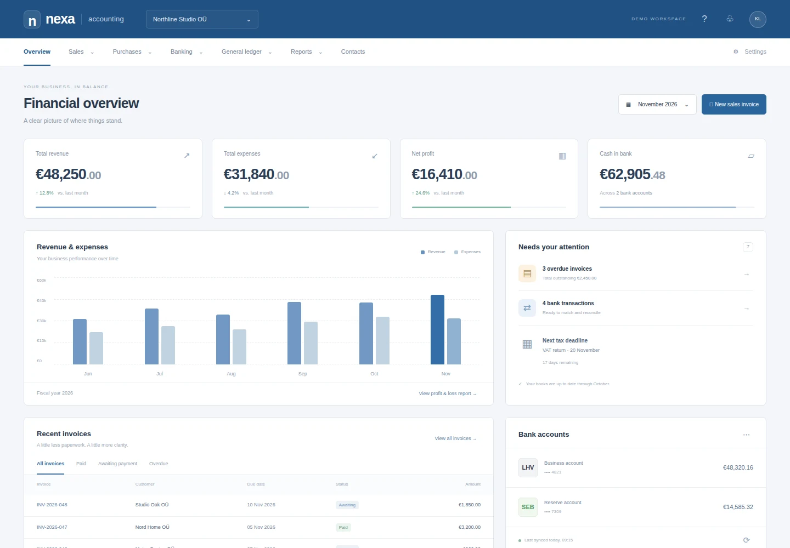

# Nexa Accounting

A Merit-inspired accounting overview: blue navigation, financial totals, revenue and expense charts, invoice tables, and bank accounts. Original Nexa interface; no Merit assets, code, or integrations are included.

[Live preview](https://nexa-accounting.nexa-templates.workers.dev/) · [Use with Nexa](https://admin.nexaintel.work)



This is a **visual template with fictional sample data**, not accounting software. Invoice status filters work locally. Other controls explain that they are previews. Figures and tax deadlines are illustrative; there is no ledger, tax calculation, bank connection, persistence, authentication, or external asset dependency.

## Run and build

Use Node.js 22 or newer. No dependency installation is needed.

```sh
npm run dev          # http://localhost:3000; PORT overrides the port
npm run build        # static site in dist/
```

Edit `index.html`, `styles.css`, and `app.js`. Figures, invoices, and chart bars are sample markup in `index.html`. GitHub Pages serves the main branch from the repository root.

## Make it yours

Choose **Use template** in Nexa, or import `https://github.com/nexa-templates/accounting.git` as a new project. Preserve upstream Git history for updates. Set a unique Worker name in `wrangler.jsonc` and deploy using the project's Cloudflare connection. No account IDs, secrets, or bindings are included.

In Nexa **Build & deploy**, select the connected Worker and production branch, use `/` as the root, `npm ci` to install, `npm run build` to build, and `npx --no-install wrangler deploy --name "$NEXA_WORKER_NAME"` to deploy. Enable automatic deployments. Run the initial build, follow its exact commit to success, and verify the saved deployment and Visit URL. Later production-branch pushes use this same pipeline. The public preview needs project sign-in disabled; it contains fictional data only.

Define the ledger, chart of accounts, invoice lifecycle, reconciliation, audit trail, access control, and reporting with an accountant before implementing real functionality. Validate local tax rules and migration balances. Demo totals do not form a reconciled ledger. There are no database migrations or integrations yet.

## Releases

- **0.1.0** — Responsive financial overview, local invoice filters, static build, and Cloudflare assets configuration.

MIT licensed. See `LICENSE`.
